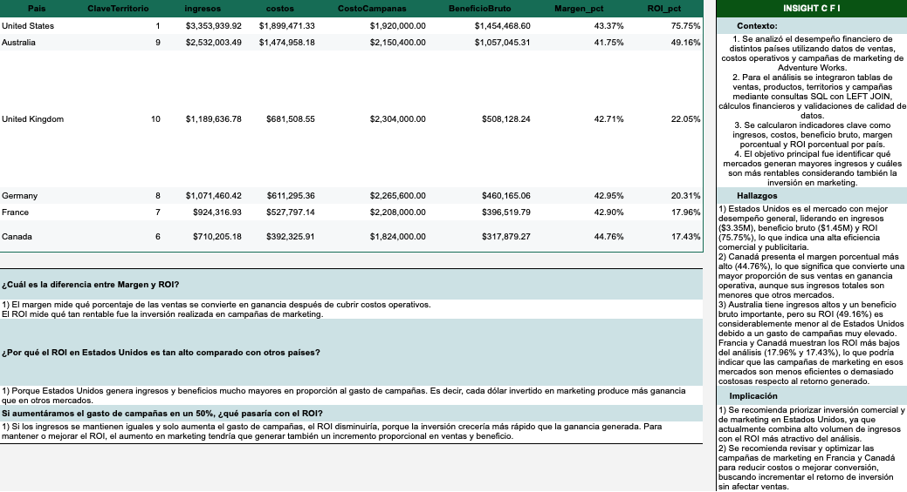

# Financial Performance Analysis with SQL

## 📌 Project Overview

This project analyzes a company's financial performance using SQL.

The objective was to transform raw transactional data into meaningful business metrics such as revenue, expenses, profit margin, and gross-profit-to-campaign-cost ratio, supporting business decision-making through data analysis.

---

## 💼 Business Problem

A company operating across multiple international markets needed to evaluate its financial performance and understand how revenue, operational expenses, and marketing investments affected profitability.

Analyzing revenue alone was insufficient to determine which markets performed best. A country with higher sales could also have higher costs, resulting in a lower profit margin or a less favorable return on investment.

This project addressed four business questions:

- Which countries generated the highest revenue?
- How did operational expenses and marketing investments affect profitability?
- Which markets achieved the strongest profit margins?
- How did gross profit relative to campaign spending differ across countries?

To answer these questions, SQL was used to calculate and compare financial performance indicators across markets.

The goal was to provide a clearer view of business performance and support data-driven decisions about cost management, profitability, and investment priorities.


## 📸 Dashboard Preview

<p align="center">
  
</p>

---

## 🎯 Objectives

- Analyze financial performance across different countries.
- Calculate key business KPIs.
- Measure profitability.
- Compare gross profit relative to campaign expenditure.
- Practice advanced SQL querying techniques.

---

## 🛠 Technologies

- SQL
- PostgreSQL
- Common Table Expressions (CTEs)
- JOINs
- Aggregate Functions
- CASE WHEN
- GROUP BY

---


## 📊 SQL Analysis & Methodology

### 1. Financial Data Analysis

The project focused on analyzing financial performance across the United States, Canada, and Australia.

The analysis considered five key financial indicators:

- **Revenue:** Total income generated by each market.
- **Expenses:** Costs associated with business operations.
- **Gross Profit:** Revenue minus the costs included in the financial calculation.
- **Profit Margin:** Profit expressed as a percentage of revenue.
- **Gross Profit / Campaign Cost:** A comparison of gross profit with campaign expenditure.

### 2. SQL Techniques

The analysis used SQL and PostgreSQL, incorporating the following techniques:

| SQL Technique | Analytical Purpose |
|---|---|
| `JOIN` | Combine information from related tables |
| `CTE (WITH)` | Organize calculations into reusable query steps |
| `SUM()` | Aggregate financial amounts |
| `GROUP BY` | Calculate metrics for each country |
| `CASE WHEN` | Apply conditional logic to financial calculations |
| Calculated expressions | Derive profitability indicators and ratios |

### 3. Financial Performance Comparison

Financial indicators were compared across markets to investigate:

- Differences in revenue generation.
- The relationship between expenses and profitability.
- Variations in profit margin.
- Differences in gross-profit-to-campaign-cost ratio between countries.

### 4. Business Interpretation

The analysis went beyond comparing sales totals.

By examining revenue alongside expenses, profit margin, and gross-profit-to-campaign-cost ratio, the project provided a broader assessment of financial performance.

These comparisons helped identify markets with different financial strengths and areas requiring further investigation.


---


## 📈 Key Findings & Business Insights

### 1. Financial Performance by Country

The analysis compared financial performance across six Adventure Works markets using SQL-based calculations.

| Country | Revenue (USD) | Gross Profit Margin | Gross Profit / Campaign Cost |
|---|---:|---:|---:|
| United States | $3,353,939.92 | 43.37% | 75.75% |
| Australia | $2,532,003.49 | 41.75% | 49.16% |
| United Kingdom | $1,189,636.78 | 42.71% | 22.05% |
| Germany | $1,071,460.42 | 42.95% | 20.31% |
| France | $924,316.93 | 42.90% | 17.96% |
| Canada | $710,205.18 | 44.76% | 17.43% |

### 2. United States: Highest Revenue and Gross Profit

The United States generated $3.35 million in revenue and approximately $1.45 million in gross profit.

It also recorded the highest gross-profit-to-campaign-cost ratio at 75.75%.

**Business Insight:**

The United States was the strongest market in terms of sales volume, gross profit, and the reported campaign investment efficiency metric.

This market warrants further evaluation for potential growth opportunities.

### 3. Canada: Highest Gross Profit Margin

Canada achieved the highest gross profit margin at 44.76%, despite generating the lowest revenue among the six markets.

**Business Insight:**

Higher sales volume does not necessarily translate into a higher profit margin.

Canada demonstrated relatively strong gross profitability per dollar of revenue, although its overall contribution was smaller.

### 4. Australia: Strong Sales with Higher Campaign Investment

Australia ranked second in revenue, generating approximately $2.53 million.

Its gross profit margin was 41.75%, while its gross-profit-to-campaign-cost ratio was 49.16%.

**Business Insight:**

Australia generated substantial revenue, but its campaign investment metric was lower than that of the United States.

Further investigation could help assess the effectiveness of its marketing expenditure.

### 5. Markets Requiring Further Investigation

France and Canada recorded the lowest gross-profit-to-campaign-cost ratios:

- France: 17.96%
- Canada: 17.43%

**Business Insight:**

These markets may benefit from a closer review of campaign costs, revenue contribution, and marketing effectiveness.

The ratios alone do not establish whether specific campaigns were profitable or caused additional sales.

### 6. Analytical Value

By combining sales, product costs, territories, and campaign information, the project demonstrated how SQL can support financial performance comparisons across international markets.

The resulting dashboard provided a consolidated view of revenue, gross profit, gross profit margin, and campaign investment ratios.

### Metric Interpretation

Gross Profit = Revenue - Product Costs

Gross Profit Margin = Gross Profit / Revenue

The dashboard's original ROI-labelled metric corresponds to:

Gross Profit / Campaign Cost

This ratio is reported as a descriptive comparison of gross profit relative to campaign spending. It should not be interpreted as a conventional net ROI calculation or as evidence of marketing-attributed incremental returns.

The analysis describes observed financial performance; it does not measure the impact of implementing business recommendations.

---

## 💼 Business Recommendations

The following recommendations are based on the financial performance analysis of six international markets.

### 1. Evaluate Growth Opportunities in the United States

**Finding:** The United States generated the highest revenue ($3,353,939.92), with a gross profit margin of 43.37% and the highest gross-profit-to-campaign-cost ratio (75.75%).

**Recommendation:** Investigate opportunities to expand successful commercial activities in the United States while monitoring product costs and campaign expenditure.

**Expected Value:** Support investment decisions using evidence of strong sales volume and gross profitability.

### 2. Investigate Canada's High Profit Margin

**Finding:** Canada achieved the highest gross profit margin (44.76%) despite generating the lowest revenue ($710,205.18).

**Recommendation:** Analyze Canada's product mix, pricing structure, and cost characteristics to understand the factors associated with its relatively high margin.

**Expected Value:** Identify potentially transferable profitability practices and assess opportunities for sustainable sales growth.

### 3. Review Marketing Expenditure in Australia

**Finding:** Australia generated $2,532,003.49 in revenue, with a 41.75% gross profit margin and a 49.16% gross-profit-to-campaign-cost ratio.

**Recommendation:** Review campaign expenditure by channel, product, and customer segment, where sufficiently detailed data is available.

**Expected Value:** Identify opportunities to refine marketing budget allocation and evaluate campaign effectiveness more precisely.

### 4. Examine Campaign Investment in France and Canada

**Finding:** France and Canada recorded the lowest gross-profit-to-campaign-cost ratios, at 17.96% and 17.43%, respectively.

**Recommendation:** Conduct a more detailed assessment of campaign costs, attributable sales, and contribution margins before making decisions about increasing or reducing advertising budgets.

**Expected Value:** Improve the quality of investment decisions and reduce the risk of relying on revenue or gross profit alone.

### 5. Establish a Financial Performance Monitoring Framework

**Finding:** The SQL analysis enabled comparisons of revenue, product costs, gross profit, gross profit margin, and campaign spending across six countries.

**Recommendation:** Monitor these indicators regularly through standardized SQL queries and a financial dashboard.

**Expected Value:** Help business stakeholders detect changes in profitability, investigate cost pressures, and compare financial performance consistently across markets.

---

**Implementation Note:** These recommendations are proposed actions derived from historical financial analysis. Their implementation and resulting business impact were not evaluated in this project.


## 📂 Repository Structure

```text
dashboard/
│── financial_performance_dashboard.xlsx

images/
│── dashboard-preview.png

README.md
```

---

## 👤 Author

**Roberto Blanco Lugo**

Data Analyst | SQL | Python | Power BI | Excel

**LinkedIn:** https://www.linkedin.com/in/roberto-blanco-lugo-/
